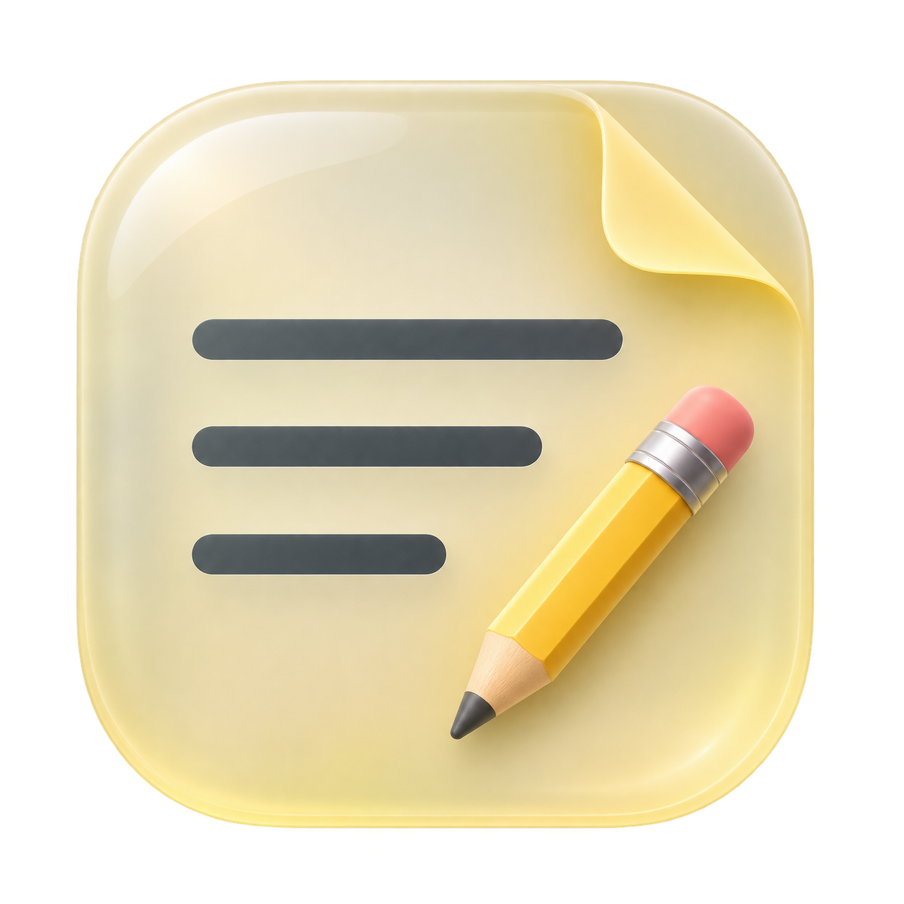

# Glass Memo



macOSのデスクトップに半透明のメモを最前面表示する、Swift / AppKit製の常駐アプリです。

## ダウンロード

[最新版のアプリをダウンロード（Apple Silicon）](https://github.com/ichikman/GlassMemo/releases/latest)

ZIPを展開し、GlassMemo.appをアプリケーションフォルダへ移動します。起動直後は画面にメモを出さず待機します。**Option + M**で表示してください。macOS 13以降に対応します。Developer ID署名・Appleの公証は未取得です。

## 操作

- **Option + M**：メモの表示／非表示（表示すると編集可能）
- **赤い閉じるボタン**：下書きを保存して完全終了
- **黄色いボタン**：メモを隠してバックグラウンドで待機（Option + Mで再表示）
- Command + W / Qのショートカットは割り当てていません。
- **Command + S**：編集中のメモをTXTとして保存
- **Esc**：編集終了（日本語変換中は変換取り消しが優先される場合があります）
- 通常時のクリックは背後のアプリへ通ります。
- 編集中にタイトルバーで移動、ウィンドウの端でサイズ変更できます。
- メニューバーのメモアイコンから編集、保存、位置リセット、終了ができます。
- 「背景の濃さ」0〜100%と「文字の濃さ」10〜100%をスライダーで個別調整できます。設定は保存されます。

起動時はメニューバーに常駐して待機します。黄色いボタンでも非表示になります。赤いボタンで終了した後はアプリを再起動してください。アプリをもう一度開くと既存のメモが表示され、二重起動しません。

## 保存

メモの下書き、位置、濃さの設定はこのMacのUserDefaults（`app.glassmemo.desktop`）に保存します。
Command + Sで `~/Documents/GlassMemo/2026-11-27_143025_メモ.txt` のような日時付きUTF-8ファイルを作成します。
同じ秒の連続保存には `_2`、`_3` などの連番を付け、既存ファイルを上書きしません。
アプリからネットワークへの送信は行いません。実際のメモや設定データはこのリポジトリに含めません。

## ビルドと起動

Apple Silicon Mac、macOS 13以降、Swiftコンパイラを含むXcodeまたはCommand Line Toolsが必要です。

```sh
zsh build.sh
open build/GlassMemo.app
```

ビルド時にローカル用のアドホック署名を行います。Developer ID署名・公証済みの配布版ではありません。

## 確認

```sh
build/GlassMemo.app/Contents/MacOS/GlassMemo --smoke-test
```

GUIセッションで実行してください。編集状態・クリック透過の設定と、日時付きTXT保存・同一秒の重複保存を確認します。
このチェックでは専用の一時UserDefaultsを使用します。

## 制限

- ログイン時の自動起動は未設定です。
- 全画面アプリやシステムの保護された画面では表示されない場合があります。
- Option + Mはほかのアプリと競合する可能性があります。登録できない場合はメニューバーから編集できます。

## ファイル

- `main.swift`：アプリ本体
- `Info.plist`：アプリバンドル設定
- `build.sh`：ビルドスクリプト
